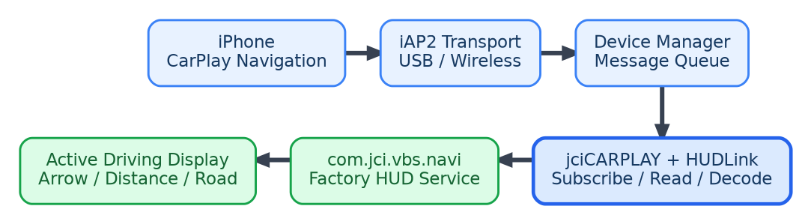

# Mazda HUDLink

**View Your CarPlay directions, on your Mazda's head-up display.** HUDLink bridges
Apple CarPlay, wired or wireless, to the factory head-up display of
first-generation Mazda Connect cars. Apple Maps and Google Maps directions
appear on the HUD the same way the built-in SD-card navigation's directions do,
and the HUD's speed and traffic sign display keeps working.

## Why

Mazda only began showing CarPlay directions on the HUD around the 2023–2024
model years. On earlier cars with the first-generation Mazda Connect head unit
(CMU150), the HUD only shows directions from the built-in SD-card navigation.
That is true whether CarPlay came from the factory, from Mazda's official
upgrade (typically around $600 at a dealer) or from an aftermarket adapter, and
no firmware update or dealer part changes it. HUDLink adds the missing link
inside the head unit. [Background](docs/background.md) has the details, the
models that came with CarPlay, and sources.

## Features

- **Live turn-by-turn directions.** The distance counts down as you drive, the
  HUD follows route recalculations, and it clears when the route ends or
  CarPlay disconnects.
- **Turn icons** for turns, forks, highway changes, ramps, U-turns, roundabouts
  with the exit to take, ferries and the destination.
- **Road names** for the road you're turning onto.
- **Speed and traffic signs** keep working next to the directions.
- **Wired or wireless CarPlay.** The bridge runs inside the head unit's own
  CarPlay process, so the connection type doesn't matter.
- **Nothing on the phone.** No app to install and no internet connection
  needed.
- **Off switch.** If CarPlay crashes while the bridge is running, the bridge
  turns itself off until it is installed again. CarPlay keeps working.

## Requirements

- A Mazda with the first-generation Mazda Connect head unit (CMU150) on
  firmware 74.00.324, and a head-up display. The second-generation Mazda
  Connect is not supported.
- An iPhone with CarPlay, connected by cable or through a wireless adapter with
  smartBox firmware (see [Known issues](#known-issues)).
- A computer with git and Docker (Docker Engine on Linux, or
  [Colima](https://github.com/abiosoft/colima) or Docker Desktop on macOS).
- A USB drive formatted as FAT32, 32 GB or smaller.

## Quick start

1. **Build the USB files:**

   ```bash
   tools/make-usb.sh --units imperial
   ```

   Use `--units metric` for meters and kilometers. The files go to `dist/usb/`.
2. **Set up the drive.** Unzip `mzd-v74-tweaks-1.0.1.zip` from the
   [mzd-v74-tweaks releases](https://github.com/piotrmocko/mzd-v74-tweaks/releases)
   to the root of the drive, then copy everything from `dist/usb/` over it. On
   a Mac, delete the hidden `._` files afterwards:

   ```bash
   find /Volumes/MYDRIVE -name '._*' -delete
   ```

3. **Back up.** In the car, plug in the drive, press **Skip** at STEP 1, then
   **Open** and **Save** at STEP 2. Copy the `backup/` folder from the drive's
   `logs/check-<date>-<time>/` folder to your computer.
4. **Install.** Plug the drive in again, press **Open** and **Install** at
   STEP 1, **Skip** at STEP 2, then **Reboot now**. Pull out the drive while
   the screen is black.
5. **Drive.** Start a route in Apple Maps or Google Maps.

Install only edits the CarPlay service entry and one device manager setting,
and adds the bridge. It tests the bridge on the head unit before changing
anything, and Uninstall puts every file back byte for byte. The
[install guide](docs/install.md) covers each step in detail, plus uninstalling,
updating, every message the installer can show, and troubleshooting.

## How it works



The iPhone already sends route guidance to the car. HUDLink runs inside the
head unit's CarPlay process, asks the iPhone for that guidance, decodes each
maneuver, and passes it to the factory HUD service through the same calls the
built-in navigation makes. [How HUDLink works](docs/how-it-works.md) covers the
message formats and the installer's checks.

## Tested

| | |
|---|---|
| Head unit | Mazda Connect CMU150, firmware 74.00.324A, North America |
| CarPlay | Wireless, through a third-party hub with smartBox firmware (Carabc "smartbox bfcf") |
| Apps | Apple Maps and Google Maps |
| On the HUD | Turn arrows, distance to the turn and road names, alongside the HUD's own speed and traffic sign display |

Tested in one car so far. Wired CarPlay reaches the bridge through the same
path inside the head unit. The original bridge was developed on the Asian (ADR)
version of firmware 74.00.324. The test car also runs other tweaks from
mzd-v74-tweaks and its own theme changes, which aren't part of HUDLink.

## Known issues

- **Waze doesn't work.** It never sends route guidance to the car, and if it's
  left open in the background it can keep the last turn on the HUD. Closing
  Waze clears it
  ([mazda-carplay-hud#10](https://github.com/KidMixer/mazda-carplay-hud/issues/10)).
- **Some wireless adapters block route guidance.** A Carlinkit CPC200-U2W
  leaves the HUD blank; adapters with smartBox firmware work
  ([mazda-carplay-hud#2](https://github.com/KidMixer/mazda-carplay-hud/issues/2)).
- **Using the navigation SD card at the same time hasn't been tested.** The
  original bridge's author warns it may cause conflicts
  ([forum post](https://www.mazda3revolution.com/threads/turn-by-turn-in-hud-with-carplay.258547/)).
- **Only firmware 74.00.324 is supported.** The installer refuses anything else.

## Documentation

- [Install guide](docs/install.md): each step in detail, uninstalling,
  updating, the installer's messages, troubleshooting and the off switch.
- [Background](docs/background.md): which Mazdas have CarPlay, why their HUD
  doesn't show its directions, and sources.
- [How HUDLink works](docs/how-it-works.md): the data path, the message
  formats and the installer's checks.
- [Building](docs/building.md): build options, tests and the repository
  layout.
- [Changelog](CHANGELOG.md): everything changed since the fork.

## About this fork

HUDLink is a fork of
[mazda-carplay-hud](https://github.com/KidMixer/mazda-carplay-hud) (AGPL-3.0)
at commit `9782e92`. Since the fork:

- Got it working over wireless CarPlay, using a diagnostic build to find out
  why the HUD stayed blank.
- Rewrote the installer from scratch: it tests the bridge on the head unit
  first, edits only what it needs to, and restores every file on uninstall.
- Cleaned up the bridge's code, which is now about 350 lines shorter, and added
  feet and miles, the off switch, Save logs with a backup, and leaner logging.
- Added reproducible builds, a USB packaging script and tests that run on a
  fake head unit.

## Credits

- **KID MIXER-MODER**,
  [mazda-carplay-hud](https://github.com/KidMixer/mazda-carplay-hud)
  (AGPL-3.0): the original CarPlay-to-HUD bridge HUDLink is forked from.
- **Trevelopment and the headunit contributors**,
  [headunit](https://github.com/Trevelopment/headunit) (AGPL-3.0): the HUD
  sender is adapted from its HUD code.
- **lmagder**, [m3-toolchain](https://github.com/lmagder/m3-toolchain): the ARM
  cross-compiler used for builds. The build container downloads it.
- **piotrmocko**, [mzd-v74-tweaks](https://github.com/piotrmocko/mzd-v74-tweaks)
  (CC BY-NC-SA 4.0): its release provides the file that starts HUDLink from the
  USB drive. None of its files are included here.
- Findings from the original project's issues by ibm0078 and AmbrosiaAS
  (wireless adapters, [#2](https://github.com/KidMixer/mazda-carplay-hud/issues/2)),
  SlendyMilky (Waze, [#10](https://github.com/KidMixer/mazda-carplay-hud/issues/10))
  and ScorpAL (a review of the original installer,
  [#6](https://github.com/KidMixer/mazda-carplay-hud/issues/6)).

Full attribution is in [NOTICE.md](NOTICE.md) and [AUTHORS](AUTHORS).

## License

GNU Affero General Public License v3.0 or later ([LICENSE](LICENSE)). The
bridge comes from mazda-carplay-hud and the HUD sender from headunit, both
AGPL-3.0, so HUDLink has to stay under the same license. Anyone who shares
HUDLink, modified or not, has to provide the source code under that license.

## Disclaimer

HUDLink is an unofficial modification. It isn't affiliated with, endorsed by or
supported by Mazda Motor Corporation, Apple Inc. or Google LLC. Mazda, Mazda
Connect, CarPlay, Apple Maps and Google Maps are trademarks of their respective
owners. Modifying your head unit's software is at your own risk and may affect
your warranty, and HUDLink comes with no warranty of any kind.
